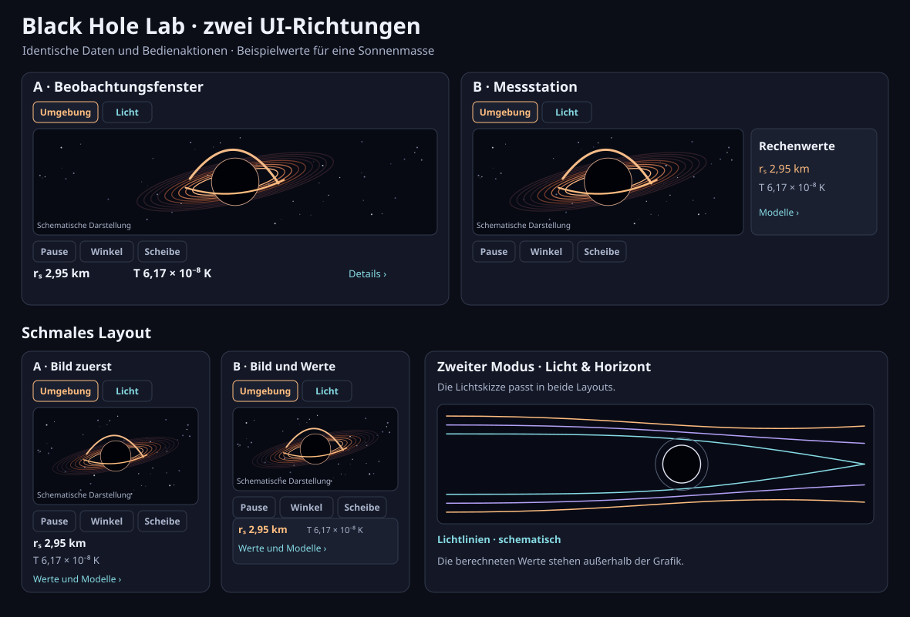
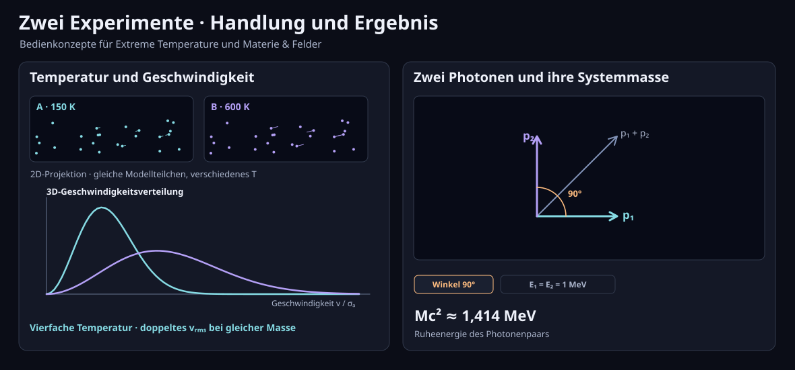
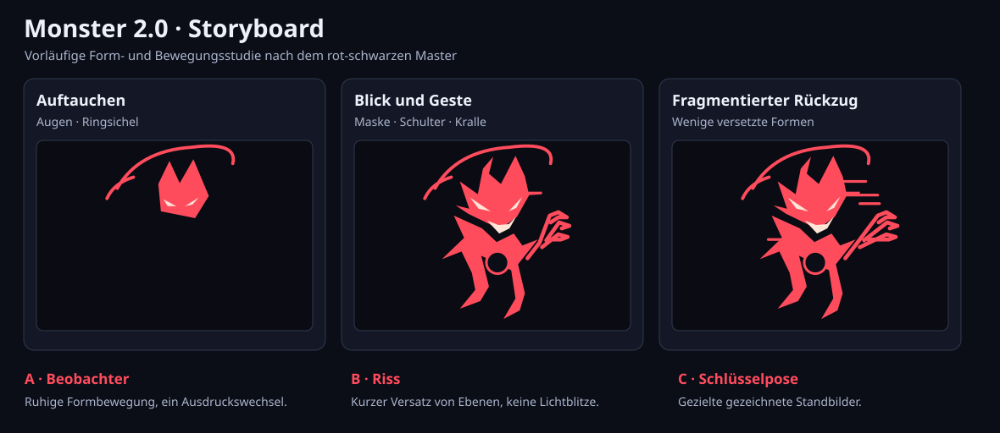
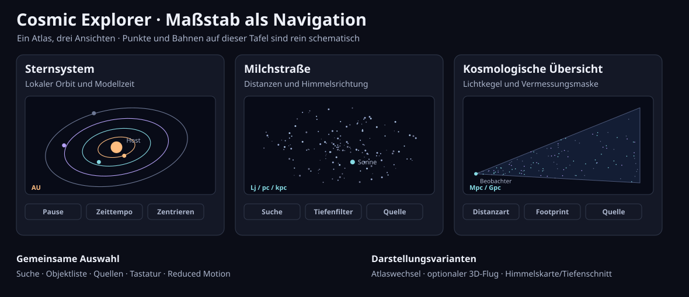

# Visuelle Konzepte · zur Auswahl

Statische Vergleichstafeln für die Planung. Farben, Bahnen und Zahlen auf den Tafeln sind Platzhalter. Bewegungsproben aus dem Master und vergleichbare Geräteaufnahmen folgen erst nach dem Bauauftrag. Alle Tafeln verwenden dieselbe dunkle Basis und dieselben Kerninhalte, damit die Entscheidung am Layout und an der Bewegungsidee hängt.

## UI und Black Hole

| Variante | Desktop und Smartphone | Wann sie passt |
| --- | --- | --- |
| **A · Beobachtungsfenster** | Bühne füllt die Breite, schmale Steuerzeile direkt darunter, kompakte Zahlenleiste, Details ausklappbar. Auf 320 px zwei kurze Modusnamen und Messwerte in zwei Zeilen. | Bildwirkung und schnelle Exploration. Empfehlung für BH und Gasbox. Nicht für Seiten mit vielen gleichzeitig notwendigen Zahlen erzwingen. |
| **B · Messstation** | Bild und kleiner Inspector stehen nebeneinander. Auf 320/390 px folgen zuerst Spielsteuerung, dann Inspector im Fluss. | Gut für Stoffvergleich, zwei Photonvektoren und Vergleichsplots. Auf engem Bildschirm weniger Platz für gleichzeitige Beobachtung. |

**Gemeinsame Richtung.** Dunkelblau bis Schwarz als Grund, warmes Amber für BH, Cyan/Lila für Temperatur-A/B, gedämpftes Violett für Materie und Rot für die Figur. Farbe dient der Zuordnung. Texte, Symbole und Einheiten tragen die Bedeutung. Keine Vollbild-Glows, keine dekorativen Nummern. Die Illustration darf gerade im BH-Lab groß sein, während die Controls mit klarer Beschriftung und ausreichender Zielfläche kompakt bleiben.

**BH-Regie.** Beide Layouts zeigen dieselbe warm geschichtete Umgebung mit Winkel und sichtbarer Vorder-/Hinterseite. Die Lichtskizze unten auf der Tafel ist ein zweiter Modus für beide Layouts. UI-Wahl A/B und physikalische Stufe sind getrennte Entscheidungen. Vergleichsaufnahmen bei gleicher Masse, gleichem Blickwinkel und gleichen Canvasmaßen. Ein Beispiel ohne Scheibe und ein Stillbild gehören zur Abnahme. Bild im Entwurf ist ausdrücklich schematisch.

## Gas und Materie

Die Gasbühne zeigt zwei Projektionen und dieselbe Geschwindigkeitsachse. Der A/B-Unterschied ist gleichzeitig im Bild, in der Kurve und als Verhältnis ablesbar. Im Materieversuch ändern der Winkelregler und die beiden Energien die Vektoren und die Systemmasse. Die beiden Experimente sind auch ohne Bewegung verständlich. Bei 320 px stehen Vergleichskästen bzw. Vektoren und Zahlenausgabe untereinander, die Achse bleibt in voller Breite.

## Monster 2.0

[Verbindliches Original der Figur ansehen](../v0.8/assets/a3-glitched-entity-master.jpg) · [Bestehendes freigegebenes Hero-Derivat](../../dist/assets/creature-candidates/hero.webp)

| Namensvorschlag | Charakter |
| --- | --- |
| **Vesper** | Ruhiger Beobachter. Kurzer, fast höflicher Blick, dann das falsche Grinsen. |
| **Rift** | Der Riss als Bewegungsidee. Taucht in Versatzstücken auf, setzt sich wieder zusammen. |
| **Null** | Trocken und minimalistisch. Versteht sich bestens mit Grenzwerten. |
| **Kern** | Kurzer Bezug zu Materie, kernige Gestik, funktioniert auch ohne übersetzten Namen. |
| **Sable** | Dunkle Silhouette und elegantere Bewegungen, weniger offensiver Glitch. |

**Empfohlene Regieprobe A · Der Beobachter.** In etwa 180 ms kommen Augen und Ringsichel ins Blickfeld, dann folgen Maske und Schulter. Die Hand hebt sich kurz, Blick/Grinsen wechseln einmal, nach kurzer Ruhe zieht sich die Silhouette zurück. Bewegungsdauer grob 0,9–1,4 s. Variante B **Der Riss** mit 2–3 versetzten Fragmentebenen zu Beginn und Rückzug, einem kurzen Schulter-/Ringversatz und einer trockenen Geste. Keine schnellen Helligkeitswechsel. Option C **Die Schlüsselpose** mit drei bis sechs gemalten, klar unterscheidbaren Posen in einem kurzen Sprite. Ausdrucksstark bei wiederholter Betrachtung, mehr manuelle Zeichnungs- und Speicherarbeit.

Die Tafelskizzen markieren Maske/Augen, Schulter/Kralle und Ringspur als mögliche Ebenen. Linienführung, Grinsen, Handform und Rot-Schwarz-Kontrast bleiben vom Original abgeleitet. Der Standbildmodus zeigt eine ruhige Hauptpose. Optionales Auslösen einer einzelnen Geste braucht eine ausdrücklich bezeichnete Aktion ohne Fokusübernahme; dekorative Figurenfläche ist nicht klickpflichtig. Kommentare kurz und selten, bei Bedarf rein visuell. Keine automatische Live-Ansage bei jedem Auftritt.

**Entscheidung zur Freigabe.** Eine Namenswahl und eine der Regievarianten. Empfohlener technischer Prototyp A als Hybrid; B erst als zweite Bewegungsprobe bei ausreichender Lesbarkeit und ruhiger Bildwirkung. Kein Name wird in dieser Planung vergeben.

## Cosmic Explorer v0.9.5

Empfohlen ist eine zusammenhängende **Atlas-Oberfläche** mit drei unterschiedlichen Raum-/Skalenansichten und derselben Auswahl-/Quellenlogik. Im Sternsystem liegt die gemeinsame Zeitsteuerung direkt an den Orbits. In der Milchstraße unterstützt ein Tiefenfilter den Wechsel zwischen Himmelsrichtung und verorteten Sternen. In der kosmologischen Ansicht werden Vermessungsmaske, Distanzdefinition und Grenzen des Modells selbst zur Navigation.

Alternative **3D-Flug** betont Raumwirkung. Ein Wechsel des Referenzrahmens bleibt dabei sichtbar, und die Flugbewegung kann ausgeschaltet werden. Alternative **Himmelskarte/Tiefenschnitt** bleibt nützlich ohne 3D-GPU, trägt Unsicherheiten gut und ist leichter statisch bedienbar. Alle drei teilen dieselben Katalogdaten. Das Beispielbild zeigt keine importierten astronomischen Daten.

## Freigabe in zwei Schritten

1. Auf Basis dieser Tafeln Layout A/B je Labor, Monster-Regie und Namen sowie gewünschte BH-Bildstufe auswählen. Für den Explorer genügt vorerst eine Vorzugsrichtung.
2. Nach einem separaten Bauauftrag nur die kleinen Proben umsetzen. Beide Layouts mit identischem Inhalt bei 320/390/1440 px, zwei Monstersequenzen am Original und BH-Varianten mit gleicher Maske/Skala vergleichen. Freigabe der visuellen Integration erst auf Grundlage dieser Proben und ihrer Gerätemessungen.
