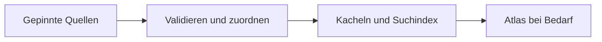

# v0.9.5 · Cosmic Explorer

Eigenständige Folgeversion mit eigener Implementierungsfreigabe. Diese Spezifikation ist eine Vorplanung. Ziel ist eine breite, durchsuchbare Objektbasis mit nachvollziehbarer Herkunft, vom einzelnen Planetensystem über die Milchstraße bis zur Verteilung beobachteter ferner Galaxien. Der Atlas zeigt immer, **welche** Distanz, welche Auswahl und welche Unsicherheit er gerade verwendet.

## Nutzerreise und Maßstab

| Ansicht | Darstellung und Einheiten | Bewusster Übergang |
| --- | --- | --- |
| Sonnensystem und ausgewähltes Sternsystem | Lokale orbital orientierte Ebene bzw. Kameraprojektion. m/km/AU, gemeinsames Zeittempo, auswählbare bekannte Körper, Pause und Zentrieren. | Auf Öffnen eines Systems wechselt die Kamera zu dessen lokalem Referenzrahmen. Ein Maßstabsbruch bleibt beschriftet. |
| Sonnenumgebung und Milchstraße | Sonnenzentrierte 3D-Positionen für Objekte mit brauchbarer Entfernung, wahlweise definierte 2D-Projektion. pc, Lj, kpc. Sterne/Punkte, Dichte bei Übersichtszoom, optional weitere Beobachtungsfelder. | Eine getrennte Himmelsprojektion zeigt Objekte ohne belastbare Distanz. Die Umstellung wird als Wechsel von Raumposition zu Himmelsrichtung sichtbar. |
| Galaxien und extragalaktischer Katalog | Lokale belastbare Entfernungsdaten gesondert; ferner nach Rotverschiebung bzw. abgeleiteter komovierender Distanz. Mpc/Gpc, Auswahl-/Abdeckungshinweis, Blick in Tiefenschichten. | Sichtbare Vermessungsmaske und gewählte Distanzdefinition. Perspektivkarte oder Winkelfläche × z-Schicht. Kein durchgehender euklidischer Raum aus gemischten Distanzen. |
| Kosmologische Übersicht | Modellabhängige Skalen, Beobachter-Lichtkegel bzw. statistische Sicht und ausgewählte Observationsdaten. Größenordnung bis ca. 14 Gpc heutiger komovierender Teilchenhorizont in einem üblichen ΛCDM-Modell. | Grenze als Modellaussage mit Himmelsabdeckung und Leerstellen. Keine interaktive Objektposition für ungeklärte bzw. nicht vermessene Regionen. |

Bedienung ähnlich Gravity. Rad und Pinch zoomen am jeweiligen Anker, Pointer verschiebt, Zentrieren stellt sinnvollen Systemausschnitt her. Tastatur bietet +/- für Zoom, Pfeile oder benannte Kameraaktionen sowie „Zentrieren“. Objektliste und Suche können jede Auswahl ohne Canvas-Gesten erreichen. Fokus bleibt in der erwarteten UI, Ergebniswechsel werden knapp angekündigt. Kameraflug optional, bei Reduced Motion direktes Zentrieren. Drag, Wheel und Tabwechsel brechen einen Flug ab.

Zoom intern in `log10(Länge je CSS-px)`. Sprünge zwischen Maßstabsmodi können den Anker über ein ausgewähltes Objekt halten, ansonsten ist der neue Ursprung beschriftet. Raster je Modus aus 1/2/5 × 10ⁿ mit stabiler Hysterese und sichtbarer Einheitenwahl; Himmelsprojektion nutzt Winkelraster und ausdrücklich keine lineare Entfernung pro Pixel. Bei perspektivischer Tiefe Gültigkeit eines Maßstabsbalkens auf die markierte Ebene beschränken. Reale Radien und Orbitdistanzen im Maßstabsmodus getrennt von auf Sichtbarkeit vergrößerten Symbolen. Projektionsabstand, 3D-Abstand und Winkelseparation sind im Inspector verschieden.

### Präzision und kosmologische Distanz

- AU als exakt 149 597 870 700 m, Lichtjahr mit Julianischem Jahr, pc als `648000/π AU`. Katalogwinkel mit Originaleinheit und Referenzrahmen importieren. ICRS-Richtung und astrometrische Epoche getrennt von ekliptikalen oder baryzentrischen Bahndaten führen. So weit verfügbar wird der Datenzeitpunkt angegeben. Eigenbewegung nur innerhalb einer ausgewiesenen Zeitspanne und mit benötigten Parametern propagieren, andernfalls feste Referenzepoche.
- CPU-Doubles für lokalen Weltursprung und Transformation, GPU-Koordinaten kamerarelativ und pro Tile normiert. Keine Subtraktion planetarer Meter aus einer einzelnen globalen kosmologischen Float32-Koordinate. Mehrere lokale Ursprünge, rekonstruierbare Einheiten, frustum-/zoomabhängiges Culling. Tests prüfen Klick- und Zoomanker beim Ursprungswechsel.
- Ein Beispielmodell für fernere z-Daten ist flaches ΛCDM mit gepinnten Parametern `H₀, Ω_m, Ω_Λ` und dokumentiertem Gültigkeitsbereich. Für moderate z mit vernachlässigbarer Strahlung `D_C=(c/H₀)∫₀ᶻ dz'/sqrt(Ω_m(1+z')³+Ω_Λ)`. Im flachen Modell `D_A=D_C/(1+z)`, `D_L=(1+z)D_C`. Rückblickzeit folgt einem anderen Integral. Für Horizont/hohes z Strahlung und den verwendeten Parameter-/Epochebezug berücksichtigen oder einen publizierten Horizontwert mit Modellquelle ausweisen. Die vereinfachte Galaxienformel wird nicht bis z→∞ extrapoliert.
- Kleine z können von Pekuliargeschwindigkeit dominiert sein. Referenzrahmen des z, Fehler und Entfernungsmethode offenlegen. Negative, fehlende oder zweifelhafte z nicht als negative oder Nullentfernung eintragen. Rotverschiebungsunabhängige Distanzindikatoren separat kennzeichnen; keinen Mittelwert über inkompatible Methoden ohne nachvollziehbares Auswahlmodell. Katalogpositionen beschreiben Beobachtungen aus verschiedenen Emissionsepochen. Die Ansicht kennzeichnet diesen Beobachtungsbezug.
- Die Kosmologie-Ansicht kann Abdeckungsgrenzen und ungleiche Stichprobendichte sichtbar machen. Ein leerer Tile, vermessener Nullbefund und Datenladefehler haben eigene Zustände. Simulierte großräumige Struktur wäre ein explizit umschaltbares, separat bezeichnetes Modell. Für diesen Release reicht die tatsächliche Katalogstruktur mit Modellskalen.

[IAU zu astronomischen Maßeinheiten](https://iauarchive.eso.org/public/themes/measuring/) · [Hogg, Distance Measures in Cosmology](https://arxiv.org/abs/astro-ph/9905116) · [Davis und Lineweaver zu verschiedenen Horizonten](https://doi.org/10.1071/AS03040) · [Planck 2018, kosmologische Parameter](https://arxiv.org/abs/1807.06209)

## Animierte Sternsysteme

### Fachliche Stufen und Datenentscheidungen

| Datenlage | Darstellung |
| --- | --- |
| Sonnensystem, geprüfte JPL-Ephemeride bzw. approximierte Elemente mit Referenzepoche | Vorab berechnete Stützstellen mit kontrollierter Interpolation oder analytische Näherung innerhalb dokumentierter Gültigkeit. JPL-Zeit-/Bezugssystem anzeigen. Für ausgewählte Planeten/Monde regelmäßig mit unabhängigen Horizons-Abfragen prüfen. |
| Kohärente gebundene Kepler-Bahn mit Lage, Phase, Zeitbasis und Epoche | Berechnete **Modellposition** aus einer katalogisierten Lösung, mit deren Zeitbezug, Fehlern und Modellgrenzen. Referenzsystem im UI. Vergleich mit Quellenepoche und unabhängigen Bahnpunkten. |
| Nur Perioden/Radiusgrößenordnung oder unvollständige Bahn | Klar beschriftete „schematische Umlaufphase“. Mit bekannter Exzentrizität kann eine projizierte Ellipse in ihrer eigenen Bahnebene gezeigt werden; fehlende Neigung/Knoten bedeuten keine reale Himmelsorientierung. Bei fehlender Exzentrizität möglicher illustrativer Kreis. Kein Kalenderzeitpunkt auf einer beliebigen Anfangsphase. |
| Kein tragfähiger Bahnmaßstab oder keine Periodeninformation | Körper bleibt auffindbar, Datenkarte und Zuordnung zum Host. Ein statisches, ausdrücklich nicht maßstäbliches Schema ist möglich. Kein ausgedachter Umlauf. |
| Mehrsternsystem oder zirkumbinärer Planet | Relative Bahnen mit richtiger Hierarchie, gegebenenfalls gemeinsames Massenzentrum bei kompatiblen Massen/Lösungen. Bei unklarer Zuordnung oder starker Dynamik Diagramm mit gemessenen Parametern statt unabhängige Keplerbahnen als Systemprognose. |

Für eine gebundene Zweikörperbahn mit `0≤e<1` und gemeinsamem Zeitbezug `M(t)=M₀+2π(t−t₀)/P`, `E−e sin E=M`, `x=a(cos E−e), y=a√(1−e²) sin E`. Bezugslage nur mit definierten `i, Ω, ω` transformieren. Newton mit Klammer/Bisektion, Iterationsbudget und endlichem Fehlerzustand. Zeitwinkel modulo 2π aus lokaler Zeitdifferenz, kein Frameakkumulationsdrift. Wenn `a` fehlt und `P` und passende Gesamtmasse bekannt sind, `a³=G(M_*+m)P²/(4π²)` als **abgeleitet**. Fehlerfortpflanzung dokumentieren; inkompatible veröffentlichte Sätze von `P, a, e` nicht kombinieren.

Für zwei bekannte Massen mit relativer Bahn `r` gilt `r₁=−m₂r/(m₁+m₂)`, `r₂=m₁r/(m₁+m₂)`. Für viele leichte Planeten ist eine primärzentrierte, ausdrücklich vereinfachte Darstellung zulässig. Das Addieren unabhängiger Zweikörperbahnen ist keine validierte Mehrkörper-Ephemeride. Interaktionen, Resonanzen und Präzession nur benennen, wenn Quellen sie hergeben. Transit-Mittenzeit ist ohne Geometrie/Umrechnung keine Periastronzeit. Retrogradbewegung nur bei bekannter Orientierung. Zeitsteuerung, Pause und Entfernungsanzeigen verändern keine Katalogdaten.

**Animation bei Auswahl.** Planeten-/Sternsymbole erhalten Tastaturäquivalente in einer Systemliste. Bahnen und Glyphen getrennt zeichnen, Hitboxen vom sichtbaren Symbol unterscheiden. Pro System dieselbe Uhr für belegte relative Perioden. Statische Bahnansicht und manuelle Zeitnavigation bleiben bei Pause/Reduced Motion bedienbar. Außenansichten animieren keine einzelnen Exoplaneten außerhalb ausgewählter Systeme. Keine Erweiterung durch erfundene Planeten.

[JPL Horizons Handbuch](https://ssd.jpl.nasa.gov/horizons/manual.html) · [JPL Approximate Positions](https://ssd.jpl.nasa.gov/planets/approx_pos.html) · [NASA Planetary Systems Spalten](https://exoplanetarchive.ipac.caltech.edu/docs/API_PS_columns.html) · [PSCompPars Herkunft und Kompositwerte](https://exoplanetarchive.ipac.caltech.edu/docs/pscp_about.html)

## Quellen, Release-Pinning und Datenrechte

| Quelle | Geplanter Nutzen | Risiken und konkrete Behandlung |
| --- | --- | --- |
| **ESA Gaia DR3** über ESA/AIP | Sterne, Himmelspositionen, Parallaxen, Eigenbewegung, Photometrie und geeignete Teilmengen. DR3 hat ungefähr 1,8 Mrd. Quellen. | Umfang und Auswahl nicht mit Zahl gut vermessener 3D-Sterne verwechseln. `source_id` als releasegebundene 64-bit-ID (String im JSON). Qualität/Selektion und Epochentransformation dokumentieren. DR4 angekündigt; die Planung pinnt ein verfügbares Release und passt das Schema erst nach einer geprüften Migration an. Gaia/DPAC-Credits pro Release. [AIP](https://gaia.aip.de/cms/data/catalogues/) · [ESA-DR3-Zitation](https://gea.esac.esa.int/archive/documentation/GDR3//Miscellaneous/sec_credit_and_citation_instructions/) · [ESA-Zeitplan](https://www.esa.int/nb/missions/about-us/directorates/science/gaia/gaia) |
| **Bailer-Jones et al., EDR3-Distanzen** | Dokumentierte geometrische oder photogeometrische Entfernungsposterior-Zusammenfassungen für große Stichprobe. | Statistische Schätzung mit Prior, nicht direkter Messwert. Mediane/Quantile, Methode und Crossmatch EDR3↔DR3 prüfen. Keine naive `1/parallax` bei kleiner Signalqualität oder negativer Parallaxe. Ohne brauchbare Entfernung bleibt der Stern im Winkellayer. [Publikation](https://arxiv.org/abs/2012.05220) |
| **NASA Exoplanet Archive** | Gesamter zum Snapshot geeigneter Bestand bestätigter Planeten und Hosts, keine Beschränkung auf kuratierte Beispiele. `PSCompPars` für Suche/Überblick. `PS` und Literatur für zusammengehörige Bahnlösungen. | Kompositspalten können aus unterschiedlichen Publikationen kommen. Bestätigung/Referenz/Asymmetrie und fehlende Felder erhalten. Zentraler Datums-Snapshot und DOI, kontrollierter Updatepfad. [Tabellen](https://exoplanetarchive.ipac.caltech.edu/docs/API_PS_columns.html) · [Credits](https://exoplanetarchive.ipac.caltech.edu/docs/acknowledge.html) |
| **JPL SSD/Horizons** | Planetensystem, geeignete Monde, später ausgewählte Kleinkörper. Validierungsreferenz. | Die JPL-API-Nutzungsregeln untersagen Website-Einbettung und parallele Abfragen. Geplanter Import mit sparsamen seriellen Abrufen, Backoff, Versionsprüfung und Cache. Vorberechnete Daten mit Ziel-/Center-ID, TDB/TT oder anderer dokumentierter Zeitbasis, Koordinatenebene und Interpolationsfehler. Zeitfenster, API-Regeln und Credits pro Produkt prüfen. [Horizons](https://ssd.jpl.nasa.gov/horizons/manual.html) · [API-Nutzungsregeln](https://ssd-api.jpl.nasa.gov/) |
| **SIMBAD/CDS** | Namens- und Aliasauflösung, Objektarten, Literatur und optionale Crossmatches. | Kein Ersatz für einen vollständigen Sternkatalog. Stabile Verlinkung zuerst. Bulk-Verwendung und Weitergabe erst nach Prüfung der CDS- und ursprünglichen Katalogbedingungen. [CDS](https://simbad.cds.unistra.fr/Pages/guide/ch02.htx) |
| **NASA/IPAC NED und NED-D** | Extragalaktische Identitäten, z und Literatur, unabhängige Distanzindikatoren. | Heterogene Daten. Mehrere Distanzschätzungen erhalten, Definition/Fehler und Herkunft. Rechte externer Teilkataloge einzeln prüfen. Bei unklarem Bulk-Recht nur zitieren/verlinken. [NED](https://ned.ipac.caltech.edu/Documents/Overview/Acknowledgments) · [NED-D](https://ned.ipac.caltech.edu/Library/Distances/) |
| **SDSS DR17** oder separat geprüfter Survey | Homogenerer Start für viele spektroskopische Galaxien mit z und Qualitätsflags. | Footprint, Auswahl und Vollständigkeit sichtbar. DR17 ist hier ein stabiler Kandidat, keine Behauptung des neuesten SDSS-Releases. Tabellen, Spektroskopiequalität, Lizenz-/Attribution und eventuelle Drittprodukte vor Rehosting prüfen. [DR17](https://www.sdss4.org/dr17/) · [Zitation](https://www.sdss4.org/collaboration/citing-sdss/) |

Quellenprüfung für diese Planung am 11.11.2026. Die Fundstellen belegen Inhalt/Zitationsanforderungen, nicht automatisch ein gemeinsames Recht zum Spiegeln. Vor Aufbereitung einer konkreten Release-Datei dokumentieren: Anbieter, Release, DOI, Lizenz/TOS und Abrufdatum, zulässige automatisierte Abfrage, Speicherung, Bearbeitung, Rehosting und Credits sowie Rechte an Bildmaterial separat. Unklarer Status ist kein pauschales Verbot der Erkundung. Datensatz bleibt bis zur Klärung externe Quelle bzw. wird durch einen geprüften ersetzt. Keine Downloadmengen oder Produktionskosten behaupten, bevor ein repräsentativer Teil gemessen wurde.

## Datenaufbereitung und Auslieferung

1. **Offline reproduzierbar.** Versionierte Query/Filter, Quellenstand und Checksums, Beispielzeilen und Fehlerstatistik. Normalize in ein schlankes Schema. Quellen-IDs, Alias und unsichere Verknüpfung erhalten; Crossmatches über veröffentlichte IDs/Katalogtabellen oder nachvollziehbares Positions-/Epochenschema mit Mehrdeutigkeitsflag. Dubletten eines Surveys oder Komponenten eines Mehrsternsystems unterscheiden. Kein unaufgelöstes Alias als sicherer Treffer.
2. **Datenvertrag.** `objectId, type, catalog, release, sourceId, aliases`; Himmelskoordinaten/Frame/Epoche, optional Distanzwert samt Methode/Quantilen/Einheit und Qualitätsstatus, optional Orbitlösung samt Provenienz/Zeitskala; Katalogwerte pro Feld mit Referenz, obere/untere Grenzen und unbekannt getrennt. Z- und Größenwerte vom abgeleiteten Modellwert getrennt. Ergebniszahlen und Coverage in Manifest. Fehlende Größe bleibt unbekannt, kein physisch großer Punktradius imitiert einen gemessenen Radius. Schema-, Index- und Datenrelease unabhängig versionieren, atomarer Wechsel per Manifest. Kachel-Header mit Version, Bounds, Anzahl, Stride, Längenlimit und Digest.
3. **Index nach Aufgabe.** HEALPix/HiPS-artige Kachelung für Himmelsrichtungen und Footprints. Gepinnte IVOA-Empfehlung, kein Zwang zu neuem Entwurfsstandard. Zusätzlich Distanzschalen mit getrennten Definitionen für Raumlayer oder lokaler Octree, wenn der 3D-Prototyp den Bedarf zeigt. Fernansicht hat Zählungen/Aggregate und Auswahlfunktion; nahe Ansicht Einzelobjekte. Sample-/Helligkeitsregeln dokumentieren und Rohzählung von dargestellter Anzahl trennen. Kein stilles Zerschneiden einer Auswahl am Kachelrand. Stabile Zellen-ID und deterministische Subsamples.
4. **Clients.** Startmanifest und kleine Übersicht zuerst; über Kamera/Filter Kacheln laden, deduplizieren und Prioritäten begrenzen. Abbruch bei Bereichswechsel, kein Rendern alter Responses in neuer Szene. Versionierte LRU-Caches für komprimierte Daten und dekodierte Buffers. Worker erst nach Messung für Decode/Index oder aufwändige Auswahl; transferierbare TypedArrays, limitierte Queue. Inspector-Literatur/Fehler erst auf Auswahl. Tastaturliste aus denselben Datensätzen. Suchindex in kleine Präfix-/Katalogteile zerlegen, Marker, Zoom und Quellenkarte nutzen dieselbe ID. Fehlerfall mit Retry, keine leere Karte als Aussage „hier gibt es nichts“.
5. **Hosting.** Erste repräsentative Datenstichprobe als versionierte statische Assets auf Entwicklungsbasis testen. Katalogpakete bei Bedarf in separate genehmigte Objektablage mit CDN, unveränderlichen Cache-URLs, CORS/CSP und Kostenlimit. Production-Pages-Plan, Datensatzanzahl und Rechte vorher prüfen. Cloudflare dokumentiert 25 MiB je Pages-Asset und 20 000 Dateien auf Free. Kachelpakete bündeln, wenn die Dateizahl das Budget erreicht; HTTP-Range-Verhalten vor Abhängigkeit testen. Kein Live-Fan-out vom Browser an wissenschaftliche Archive. Kein Backend, Secret oder Domainwechsel als impliziter Teil von v0.9.
6. **Größenordnungen für die Planung.** Bei 32 B pro kompaktem Displaydatensatz sind 100 000 Objekte ungefähr 3,05 MiB, 1 Mio. ungefähr 30,5 MiB roh. Alias, Details, Unsicherheiten, Wiederholung in LODs und Index kommen hinzu. Transparente Budgetrechnung mit Benchmarkdaten. Ziel für eine erste große, repräsentative Ausbaustufe **100 000–1 000 000** per Tile erkundbare Sterne plus **Zehntausende** spektral geprüfte Galaxien, je nach Stichprobe/Rechten/Hosting. Alle geeigneten bestätigten NASA-Archive-Systeme im gepinnten Snapshot durchsuchbar; Zahl der nach den Bahnregeln animierbaren Systeme und Gründe für fehlende Bahnen separat ausweisen. Das sind Abnahme-/Ausbauziele, keine gezählten Imports und kein Gesamtlimit. Architekturprobe mit 1 Mio. + 10 Mio. synthetischen Lastdatensätzen ausschließlich im Test, im echten Atlas ausschließlich reale Objekte oder klar bezeichnete Aggregate.
7. **Betrieb.** Release-Manifest zeigt Quellen, Abfragezeit, Abdeckung, ausgeschlossene Gründe und Objektzahlen. Historische Referenzdaten versionieren. Neuer Katalogstand zuerst offline reproduzieren und die kleinen QA-Samples mit unabhängigen Archivabfragen vergleichen. Kacheln maximal einmal pro Datenversion je Cache-Key. Kein unbegrenztes Prefetch. Erste Schätzung für 1 Mio. Displaypunkte plus Detaildaten im gehosteten Paket grob 50–250 MiB, abhängig von Metadaten und Kompression. Traffic und Betriebskosten nach gemessenen Transfer- und Wiederbesuchswerten rechnen.

[IVOA HiPS 1.0](https://www.ivoa.net/Documents/HiPS/20170519/index.html) · [Cloudflare Pages Plattformlimits](https://developers.cloudflare.com/pages/platform/limits/)

## Renderer und Qualitätsstufen

| Variante | Stärke | Freigabeentscheidung |
| --- | --- | --- |
| Canvas 2D und DOM | Einfacher, gute statische/mobile Alternative, begrenzte Punktmengen und Orbitlinien, nutzbare CPU-Last bei klaren Budgets | Als Basis für Systemansicht und Low/Static-Ansichten. Kein Zeichnen jedes Katalogpunkts bei Weltzoom. |
| WebGL2 und DOM | Punktbatches, Instancing und kamera-relative Transformation für viele Objekte; GPU-Effekte innerhalb eines begrenzten Kontextes | Empfohlene erweiterte Desktop-/Mobilspur, wenn die reale Probe bei gleicher Abdeckung bessere Kosten zeigt. Kontextverlust, Low-Fallback, visuelle Parität der wissenschaftlichen Inhalte abnehmen. |
| WebGPU | Potenziell mehr Compute-/Batch-Kontrolle bei großen Layers | Kein Releasezwang. Feature Detection und Wartungskosten gegen gemessenen Vorteil. Kein eigener paralleler Stack allein aufgrund der Technologie. |

Bewegung und Darstellung getrennt. Eine Uhr nur für das ausgewählte sichtbare System, ein aktiver Renderer. Bei Pause/Stillstand, Hidden/Offscreen und Reduced Motion ruhende Karten ohne RAF. Drag/Zoom aktualisiert bedarfsgesteuert. GPU-/Worker-Ressourcen begrenzen, frustum-/LOD-Tests, Dispose löscht Buffers und inaktive Listener. On-demand laden, Qualitätsstufe begrenzt Objekt-/Labelzahl und DPR, bewahrt Auswahl, Einheiten und Quellen. Keine GPU-Voraussetzung für Datensuche. Zielprofile und messbare Grenzwerte stehen in [Etappen und Abnahme](05-etappen-und-abnahme.md#leistungs--und-ressourcenbudgets).

[MDN WebGL API](https://developer.mozilla.org/en-US/docs/Web/API/WebGL_API) · [MDN WebGPU Verfügbarkeit](https://developer.mozilla.org/en-US/docs/Web/API/WebGPU_API)

## Drei Richtungen zur Freigabe

- **Atlas aus drei Ebenen** mit klaren Maßstabswechseln. Interaktion vertraut, besonders mobil, wissenschaftlich am klarsten. Empfehlung als Grundlage.
- **Durchgehender 3D-Kameraflug** mit getrennten Bezugsrahmen und sichtbaren Wechseln. Größere visuelle Wirkung, mehr GPU-/Präzisions- und Orientierungsrisiko. Als optionale Desktop-Verbesserung auf derselben Datenstruktur prüfen.
- **Himmelskarte und Tiefenschnitt** als gleichwertige wissenschaftliche Ansichten. Sehr gut bei fehlender Distanz oder ungleicher Abdeckung; weniger räumliche Inszenierung. Als Low/Static-Einstieg und Abdeckungsebene vorsehen.

Siehe [Explorer-Vergleichstafel](03-visuelle-konzepte.md#cosmic-explorer-v095).
